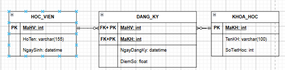

### Xác định

| **Entity** | **Attribute cần lưu**  | **Khóa chính (PK) đề xuất** |
| ---------------- | ------------------------------ | -------------------------------------- |
| HOC_VIEN         | MaHV, HoTen, NgaySinh          | MaHV                                   |
| KHOA_HOC         | MaKH, TenKH, SoTietHoc         | MaKH                                   |
| DANG_KY          | MaHV, MaKH, NgayDangKy, DiemSo | MaHV + MaKH                           |

### Vẽ ERD

### Chuẩn hóa dữ liệu

| **MaHV** | **MaKH** | **TenKH**        | **DiemSo** |
| -------------- | -------------- | ---------------------- | ---------------- |
| HV01           | KH01           | Nhập môn Lập trình | 8.5              |
| HV01           | KH02           | Thiết kế CSDL        | 9.0              |
| HV02           | KH01           | Nhập môn Lập trình | 7.0              |

Cột đăng vi phạm chuẩn của 2NF là Tên KH vì nó chỉ phụ thuộc vào MaKH nhưng không không phụ thuộc vào MaHV nên điều cần sửa ở đây ta sẽ chuyển tên KH chuyển sang KHOA_HOC và DANG_KY với các thuộc tính: MaHV, MaKH, DiemSo
